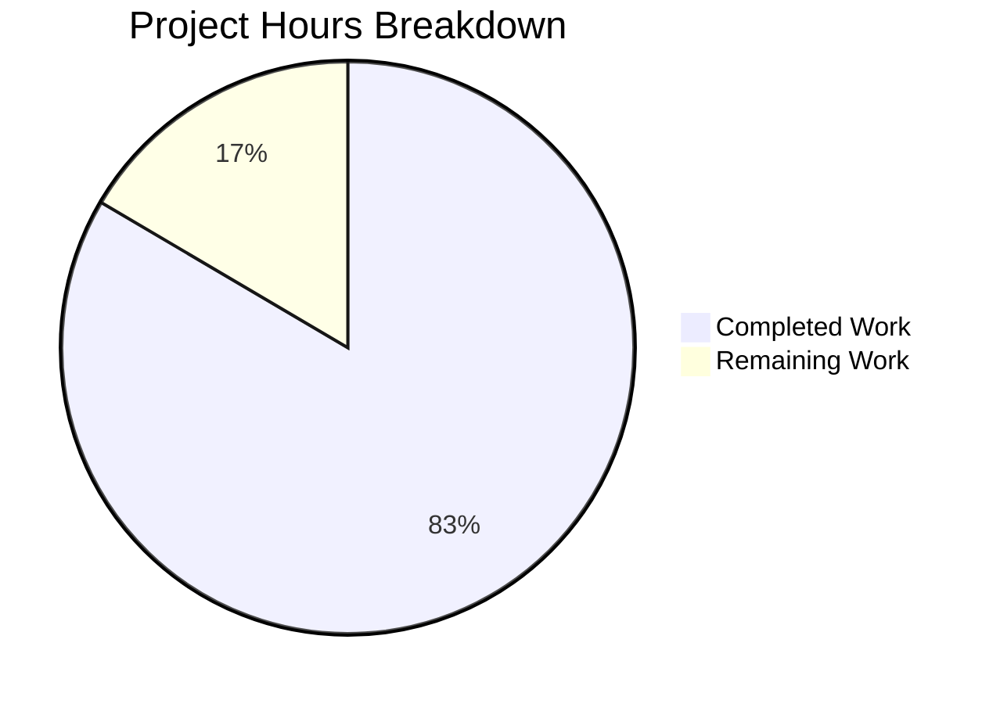
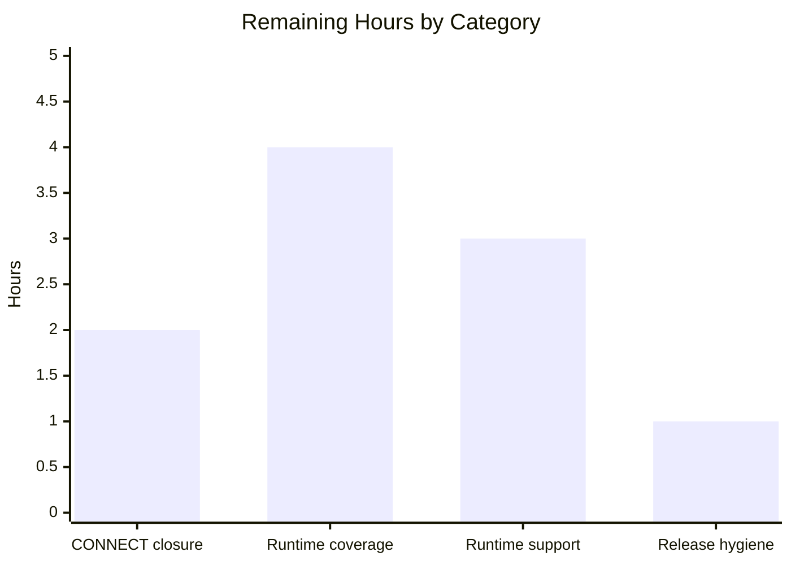

# 1. Executive Summary

## 1.1 Project Overview

`nodejs-tutorial-hello-world` is a single-file Node.js HTTP server tutorial with zero third-party dependencies, importing only `node:http`. It answers `GET /hello` with `200 text/plain` and the body `Hello world`, answers every other method and path with `404 text/plain` and `Not Found`, logs one line per request to stdout, resolves its port from `PORT` (default 3000, range 1024–65535), prints an actionable one-line diagnostic when that value is unacceptable or the port is taken, and shuts down gracefully on SIGINT. It targets a beginner learning Node.js HTTP fundamentals on a developer machine. The delivery is three files — `server.js` (162 lines, ten functions), `package.json` (seven pinned fields, no dependency key) and `README.md` (279 lines, eight sections) — with no build, no install and no configuration beyond the port.

## 1.2 Completion Status

**83% complete** — 50.5 of 60.5 project hours delivered and verified. Completed Work is Dark Blue `#5B39F3`; Remaining Work is White `#FFFFFF`.



| Metric | Hours |
| --- | --- |
| Total Hours | 60.5 |
| Completed Hours (AI + Manual) | 50.5 (all autonomous; 0 manual) |
| Remaining Hours | 10 |
| Percent Complete | 83% (50.5 / 60.5) |

## 1.3 Key Accomplishments

- ✅ Both response contracts verified through curl, a raw socket and a browser.
- ✅ Routing: query stripped before matching, exact comparison, no percent-decoding, `HEAD` answered without a body.
- ✅ One ISO-8601 request record per accepted request, written before routing, 404s included.
- ✅ Port rules verified for the default, an override, an empty value and eight rejected classes.
- ✅ A second instance on a live port refused with the pinned message; the first keeps serving.
- ✅ SIGINT: one shutdown line, exit status 0, port released; SIGTERM keeps the runtime default.
- ✅ Latency, concurrency and memory with wide margins: 0.0009 s and 0.85 ms peaks, 50-way bursts all 200, +68 kB over 2,000 requests.
- ✅ An eight-section README matching behaviour character for character, in a tree with no dependency, secret or outbound call.

## 1.4 Critical Unresolved Issues

**10 of the 37 scoped requirements carry an open item; 27 are closed with no caveat.** Each is a residual caveat or a path no verification reached.

| Issue | Impact | Owner | ETA |
| --- | --- | --- | --- |
| **Contract gap — 1 item.** The transport-level `CONNECT` method receives no HTTP response and writes no request record (`server.js:83-118` registers only `'request'`, `'listening'` and `'error'`), against the catch-all contract the other methods follow | A CONNECT client waits for a reply that never comes; the exception is disclosed in `README.md:112-115` and the connection is closed | Maintainer | 2 h |
| **Verification coverage — 3 items.** The generic non-EADDRINUSE bind branch, the post-bind error branch, and a repeated CTRL+C during an in-progress shutdown were not reachable at runtime in this environment | Those paths are exercised only by reading; a defect in them would not have been seen | Maintainer with host privileges | 4 h |
| **Runtime support window — 2 items.** `engines.node` is `>=18.0.0`, and Node 18 reached end-of-life on 30 April 2025; the README's Node 18.0.x/18.1.x and 26.4.0-and-above shutdown bands cannot be executed where only v22.23.3 is installed | An operator who satisfies the declared floor runs an unpatched runtime, and the documented breadth rests on the runtime's semantics | Maintainer | 3 h |
| **Deployment posture — 2 items.** The server binds the unspecified address with no host option, and SIGTERM is deliberately not intercepted | Reachable on every local interface rather than loopback alone; a supervisor's stop exits 143 without draining | Operator | Documented; accepted by design |
| **Availability — 1 item.** An unread request body grows resident memory toward the payload size (~31 MB per 64 MiB, retained), with no body-size cap, request timeout or rate limit | A client that keeps sending raises memory use; now disclosed in `README.md:116-131` | Maintainer | ≤1 h (Section 2.2) |
| **Release hygiene — 1 item.** The manifest omits `private` and `license` while claiming a name that is unregistered on the public registry | A stray `npm publish` could claim a free public name | Maintainer | ≤1 h (Section 2.2) |

## 1.5 Access Issues

No access issues identified. Verification and operation need only Node.js and curl; the project holds no credential, secret or third-party account.

## 1.6 Recommended Next Steps

1. **[High]** Close the CONNECT contract gap or adopt the documented exception (2 h).
2. **[Medium]** Reach the two bind-failure branches and the version-scoped shutdown bands where testable (4 h).
3. **[Medium]** Move the runtime floor off Node 18 and re-run acceptance (3 h).
4. **[Low]** Record the publish-safety and availability-posture decisions (1 h).
5. **[Low]** Adopt the Section 9 acceptance procedure as the release gate.

# 2. Project Hours Breakdown

## 2.1 Completed Work Detail

| Component | Hours | Description |
| --- | --- | --- |
| HTTP response contract and routing | 8 | `sendText` as the single response writer, the 200 and 404 contracts with their literal bodies, the `ROUTES` dispatch table, the once-only path derivation that drops the query string, and the exact-match behaviour behind HEAD, absolute-form and asterisk-form targets (`server.js:45-81`). |
| Port configuration and validation | 5 | `parsePort` with its digit-only rule, inclusive 1024–65535 range, unset/empty default of 3000, and the single-line diagnostic that quotes the received value and names the range and the corrective action (`server.js:11-39`). |
| Bind-failure diagnostics and exit statuses | 4 | The EADDRINUSE message with its range-guarded suggested port, the generic non-EADDRINUSE message, the post-bind error classification, and exit statuses carried by `process.exitCode` rather than `process.exit()` (`server.js:91-116`). |
| Request logging | 2 | `logRequest` and its call site before the routing decision: one ISO-8601 three-field record per accepted request, with nothing request-derived beyond the method and the query-free path (`server.js:41-43,74-81`). |
| Graceful shutdown and lifecycle | 4 | The SIGINT path, the once-only shutdown guard, the exit-status guard that preserves a recorded failure, the feature-checked idle-connection close, and the decision to leave SIGTERM to the runtime (`server.js:83-146`). |
| Manifest and packaging | 2 | The seven-field manifest with its pinned values, the zero-dependency posture, the `npm start` entry point and the declared engine floor (`package.json`). |
| Documentation — the eight README sections | 10 | Purpose, prerequisites, installation, execution, testing, expected output examples, shutdown and PORT configuration, with every command, response block, log line and message aligned to implemented behaviour character for character (`README.md`). |
| Runtime verification | 15.5 | The acceptance procedure and the wider passes it was extended with: contract and matching matrices, the configuration matrix, log-record checks, latency and concurrency measurement, the memory comparison, security probes, lifecycle checks and a browser pass. |
| **Total** | **50.5** | |

## 2.2 Remaining Work Detail

| Category | Hours | Priority |
| --- | --- | --- |
| Divergence closure — answer the transport-level CONNECT method with the same 404 contract and a log record, or record the documented exception as the adopted contract | 2 | High |
| Runtime coverage — exercise the generic non-EADDRINUSE and post-bind error branches where a bind can genuinely fail, and verify the documented Node 18.0.x/18.1.x and 26.4.0-and-above shutdown bands on those runtimes | 4 | Medium |
| Runtime support — move `engines.node` off Node 18 to a supported LTS line, drop the feature check it makes unnecessary, and re-run the acceptance procedure | 3 | Medium |
| Release hygiene — decide and record publish-safety (`private`/`license`, or a publish guard) and the availability posture for unread request bodies | 1 | Low |
| **Total** | **10** | |

## 2.3 Hours Basis

Completed hours are sized per component from what the tree contains and what was observed running: implementation weight for a small but error-path-dense module, plus the 30–40% share of effort that verification consumes, plus the documentation effort that a byte-exact README requires. Remaining hours are sized from the three specific paths no run reached and the two decisions the owner still has to take, not from a general allowance. Section 2.1 + Section 2.2 = 60.5 hours, and 50.5 / 60.5 = 83% complete; both partially completed requirements sit inside the completed components above, with their outstanding fraction carried in Section 2.2, so no hour is counted twice.

# 3. Test Results

No automated test suite exists — the project deliberately ships no test file, runner or coverage target, and `npm test` exits 1 with `Missing script: "test"`. Correctness is exercised by the project's documented acceptance procedure, which was run end to end against the delivered tree on Node v22.23.3 with npm 11.21.0 and curl 8.14.1, plus a pass in headless Chrome. **76 checks executed, 76 passed, 0 failed.** Every count below is a check that was run and whose result was read.

| Area / Category | Framework | Tests | Passed | Failed | Coverage | What This Proves |
| --- | --- | --- | --- | --- | --- | --- |
| HTTP response contract (the 200 path) | None — curl and headless Chrome | 8 | 8 | 0 | Not measured — no coverage tooling is in scope | `GET /hello` answers 200 `text/plain` with a byte-exact 11-byte `Hello world` body, in curl and in a browser, with no charset parameter and only the status code and media type set by the application. |
| Route matching and the catch-all 404 | None — curl and raw-socket clients | 16 | 16 | 0 | Not measured | Every other method and path — including the root, a trailing slash, upper case, a double slash, an unmatched method, a percent-encoded path, an absolute-form target and `OPTIONS *` — yields the 404 contract, and `HEAD /hello` answers 404 without a body. |
| Request logging | None — stdout capture | 6 | 6 | 0 | n/a — line counts | Exactly one record per accepted request, in the fixed `<ISO-8601> <METHOD> <path>` form, written before the routing decision, with the query string stripped and no body, header, status or client address ever captured. |
| Port configuration, validation and bind failure | None — process launches with exit statuses | 20 | 20 | 0 | Not measured | The default, override and empty-value resolution rules hold; eight rejected value classes exit 1 with the exact one-line diagnostic and nothing bound; and a second instance on a live port is refused with the pinned message while the incumbent keeps serving. |
| Startup latency (N1) | None — `curl -w` samples and an in-process keep-alive client | 2 runs (210 samples) | 2 (210) | 0 | Not measured | Every latency sample sits an order of magnitude inside the 10 ms bound by both documented measurement methods: 20 curl samples with a 0.0009 s maximum, and a 190-sample keep-alive client with a 0.85 ms maximum. |
| Request concurrency (N2) | None — parallel curl bursts | 2 | 2 | 0 | Not measured | 20-way and 50-way simultaneous bursts are each answered entirely with 200s, with no connection, pool or timeout error and no change to the following latency. |
| Memory under repeated requests (N3) | None — resident-memory readings around load | 3 | 3 | 0 | Not measured | 2,000 sequential requests move resident memory by 68 kB, so repeated traffic does not grow the process; and a 64 MiB unread upload moves it by ~31 MB, which is the measured, documented cost of never reading a request body. |
| Lifecycle, launcher and packaging gates | None — signals, exit statuses, `node --check`, manifest parse | 19 | 19 | 0 | Not measured | SIGINT prints exactly one shutdown line, exits 0 and releases the port (a follow-up request fails to connect, and the port rebinds); SIGTERM keeps the runtime default of 143 with no shutdown line; `npm start` prints npm's own preamble and serves the same contract; the source parses cleanly and the manifest carries exactly its seven pinned fields. |

## Not Covered

- **The generic non-EADDRINUSE bind branch** (`server.js:107-113`) — the path was unreachable in this environment, because no port in the accepted range can be refused by privilege. To test: run on a host where such a bind can genuinely fail, and assert one stderr line naming the error code and exit status 1.
- **The post-bind error branch** (`server.js:92-97`) — reached only by an error raised after a successful bind. To test: force an accept-time failure on a bound server (for example a very low file-descriptor limit) and confirm the runtime's own error is written while the server keeps serving and the exit status is unaffected.
- **A repeated CTRL+C during an in-progress shutdown** — the once-only guard is present in the code but was not driven twice at runtime. To test: hold a half-open request, send SIGINT twice, and assert exactly one shutdown line and exit status 0.
- **The documented Node 18.0.x/18.1.x and 26.4.0-and-above shutdown bands** (`README.md:223-238`) — only v22.23.3 is available here, so those version-specific statements rest on the runtime's semantics rather than on observation. To test: repeat the idle-connection shutdown scenario on each documented runtime.
- **The transport-level CONNECT method** — not covered by any assertion, because the method receives no response at all (see Sections 1.4 and 5.2). To test: send a CONNECT on a raw socket and assert the response and the log record once the contract is settled.
- **Nothing is a regression gate.** With no framework in scope, these results are reproducible by following Section 9, but a future edit has no automated check behind it.

# 4. Runtime Validation & UI Verification

- ✅ **Startup and port resolution** — the server started on the default port 3000, on an explicit override, and with an empty `PORT`; each run printed its single resolved-port line and wrote zero bytes to stderr, and the first request after each start succeeded.
- ✅ **Primary journey — `GET /hello`** — 200 `text/plain`, `Content-Length: 11`, body `Hello world` delivered identically to curl, to a raw socket and to headless Chrome, 20 repetitions with one stable body hash.
- ✅ **Catch-all routing** — 16 request forms driven: the root, unmatched paths, a trailing slash, upper case, double slashes, percent-encoded paths, `POST`/`PUT`/`DELETE`/`OPTIONS`, an absolute-form target, asterisk-form, and `HEAD /hello` — every one answered with the 404 contract, the `HEAD` case without a body.
- ✅ **Request logging** — every driven request produced exactly one stdout record in the documented three-field form, 404s included, with the query string stripped; the four-step walkthrough produced a startup line plus four records.
- ✅ **Port validation** — eight invalid values (`abc`, `80`, `70000`, `3000.5`, `-1`, `1023`, `65536`, `0x10`) launched and observed to exit 1 with the exact diagnostic on stderr, no stdout output, and no socket created.
- ✅ **Bind failure** — a second instance on a port already held exited 1 with the pinned EADDRINUSE message naming an in-range example port, while the first instance stayed healthy and served 200.
- ✅ **Shutdown** — SIGINT produced exactly one shutdown line, exit status 0 and a released port (the next request failed to connect, and the port rebound immediately); SIGTERM kept the runtime default of 143 with no shutdown line.
- ⚠ **Transport-level CONNECT** — the connection is closed with zero response bytes and no log record, and the exception is disclosed in `README.md:112-115`; this is the one runtime behaviour that departs from the catch-all contract the other methods follow.
- ✅ **Browser rendering** — Chrome received the same statuses, media type and byte counts as curl, over HTTP/1.1 keep-alive with eight requests on one reused connection, with zero window errors, zero unhandled promise rejections and zero application-caused failed resources (the only console entries were Chrome's own per-404 network-status lines).
- ⚠ **Never exercised at runtime** — the generic non-EADDRINUSE and post-bind error branches, a repeated CTRL+C during shutdown, and the documented Node 18.0.x/18.1.x and 26.4.0-and-above shutdown bands. There is no external integration to exercise: the server makes no outbound call, reads no file and depends on no service, database or credential.

# 5. Compliance & Quality Review

## 5.1 Compliance Matrix

| Deliverable | Verified Status | Progress | Verified In |
| --- | --- | --- | --- |
| `GET /hello` contract — 200, `text/plain`, `Hello world`, 11 bytes | ✅ PASS | 100% | `server.js:45-57,59-61`; observed in curl, a raw socket and a browser |
| Catch-all 404 contract — every other method and path | ⚠️ PASS WITH ONE DISCLOSED EXCEPTION | 95% | 16 request forms 404 as specified; transport-level CONNECT answered with no response (`README.md:112-115`) |
| Request logging — one record per request, before routing | ✅ PASS | 100% | `server.js:41-43,74-81`; record counts reconcile with accepted requests, query stripped, 404s logged |
| Port configuration and validation — default, range, one-line diagnostic | ✅ PASS | 100% | `server.js:11-39,148-160`; eight rejected classes exit 1 with the pinned message and nothing bound |
| Bind-failure diagnostics — EADDRINUSE and generic messages | ⚠️ PARTIAL | 85% | EADDRINUSE observed live with its range-guarded suggestion; the generic and post-bind branches were unreachable here |
| Graceful shutdown and signals — SIGINT drain, exit 0, SIGTERM default | ✅ PASS | 100% | `server.js:83-146`; one shutdown line, exit 0, port released and rebindable; SIGTERM exits 143 with no line |
| Performance targets — latency, concurrency, memory stability | ✅ PASS | 100% | 20 curl samples max 0.0009 s, 190-sample client max 0.85 ms, 20- and 50-way bursts all 200, +68 kB over 2,000 requests |
| Structural constraints — three artefacts, zero dependencies, single response writer, no `process.exit()` | ✅ PASS | 100% | 3 tracked files, one `require('node:http')`, the only response-writing site is `sendText`, no `process.exit(` call |
| Security boundaries — no evaluation, filesystem or outbound call; no reflection; log integrity | ✅ PASS | 100% | `server.js` whole file; 0 secrets, 0 dependency keys, both bodies are literals, logged values cannot restructure a record |
| Documentation — the eight required sections, byte-exact against behaviour | ✅ PASS | 100% | `README.md` (1 title + 8 sections), every command, block, log line and message reproduced character for character |
| Code quality — formatting, no placeholders, reasoned comments | ⚠️ PASS WITH A DOCUMENTED NOTE | 90% | 0 markers, 0 tabs, 0 trailing whitespace, longest line 91 characters; seven comment sites where the plan names three (Section 5.2, D6) |
| Runtime support and deployment posture — engine floor, bind address, signals | ⚠️ ACCEPTED AND DOCUMENTED | Documented | `package.json:9-11`, `server.js:118`, `server.js:120-128`; each decision recorded in Section 1.4 with its risk in Section 6 |

## 5.2 AAP & Rule Divergences and Gaps

| # | What the AAP/Rule Required | What Was Delivered Instead | Why It Diverged | Impact | Remediation |
| --- | --- | --- | --- | --- | --- |
| D1 | "Any other method → 404" for every method (0.5.3 rows 2–3) | No `'connect'` listener: a CONNECT is closed with zero bytes and no log record (`server.js:83-118`) | The runtime hands CONNECT to a bare socket with no response object, and answering it requires a second response writer that 0.5.1 forbids | A CONNECT client gets no reply; every other form matches the contract | Implement the raw-socket 404 and its record, or adopt the disclosure at `README.md:112-115` (2 h) |
| D2 | The diagnostic "names the received value in quotes" (0.5.5) | Control characters in the value are rendered as `\uXXXX` before quoting (`server.js:16-21`) | 0.5.5 also requires one stderr line per rejection; a raw newline would split it or forge a second line | A value containing a control character is reported escaped rather than verbatim | None needed; disclosed at `README.md:275-277` |
| D3 | The console surface comprises five record kinds (0.5.4/0.5.5) | An error raised after a successful bind is written to stderr as the runtime's own error (`server.js:92-97`) | Treating it as a bind failure would print a startup-failure message naming a port while the server keeps listening | One extra stderr shape exists for a post-bind failure that no run reached | Exercise the branch and confirm the record, or classify the runtime error (inside the 4 h of Section 2.2) |
| D4 | The shutdown line is written as the first statement of the SIGINT handler (0.5.5), a second CTRL+C being "harmless" (0.5.1) | A once-only guard means a second CTRL+C prints nothing (`server.js:85,122-126`) | One record per process lifetime is the stricter reading of 0.5.1's "harmless", and duplicates would misreport a single shutdown | A second CTRL+C is silent rather than repeating the line | None needed; the guard is a deliberate tightening |
| D5 | The close callback sets exit status 0 (0.5.5) | The callback sets 0 only when nothing has recorded a failure (`server.js:136-138`) | Requirement R6 makes a failed start exit 1; a SIGINT after a bind failure would otherwise overwrite that status | A failed start keeps its status instead of being reported as a clean exit | None needed; the guard preserves a higher-ranked requirement |
| D6 | Comments only where a reader must otherwise infer a reason — three places named (0.12.1) | Seven reasoned comment sites (`server.js:16-17,75-76,93-94,121,134-135,141-142,152-153`) | Each states a reason a name cannot convey (escaping rationale, query strip, post-bind classification, once-only shutdown, exit-status guard, version guard, status instead of a throw) | More prose in the source than the plan anticipated; no effect on behaviour | Optional: fold the four lifecycle notes into a single block, or leave as delivered |
| D7 | All three artefacts are created and nothing is modified (0.8.1); the eight sections cover the enumerated items (0.5.6) | `README.md` replaced a tracked two-line scaffold in place, and its sections carry extra prose (CONNECT exception, unread-body cost, all-interfaces bind note, npm's blank preamble line) | The scaffold already existed in the tree, and each added passage states behaviour the sections would otherwise misrepresent | The document is longer than the enumeration, and every addition is behaviour that was observed | None needed; each addition verifies against the running server |
| D8 | "Never reading the body is what keeps an unbounded upload from becoming this server's problem" (0.2.1) | The body is still never read, but a 64 MiB unread upload moves resident memory by ~31 MB, retained and reused on equal-size re-uploads (`server.js:74-81`; `README.md:116-131`) | The runtime buffers and discards unread request data on the process's behalf; a size cap or request timeout is deliberately outside the plan's scope | A client that keeps sending raises memory use; no data is stored and nothing accumulates per request | Keep the server on a trusted network (now disclosed), or bound the body and add a timeout in a future revision (decision inside the 1 h of Section 2.2) |

**D1 — the CONNECT gap.** The endpoint contract says any other method is answered with the 404, and every method except CONNECT is. The reason it is not is structural: the runtime delivers CONNECT on its connection-level transport with a bare socket and no response object, so answering it would need a writer outside `sendText` — the one place `0.5.1` says a response is written. The delivered code registers only `'listening'`, `'error'` and `'request'` (`server.js:83-118`) and the exception is stated to the reader at `README.md:112-115`. Nothing else is affected: `OPTIONS *`, absolute-form targets, unmatched paths and `HEAD` all return the documented 404 with a log record. The owner either implements the raw-socket reply with its record, or records the disclosure as the contract; Section 2.2 budgets two hours.

**D2 — the escaped port value.** Requirement 0.5.5 says the diagnostic names the received value in quotes, and it also requires that a rejection produce exactly one stderr line. A value containing a newline satisfies both only if the newline is escaped, so `server.js:16-21` replaces the Unicode Cc range with `\uXXXX` before splicing the value into the single-line record, and the range and corrective action stay intact. Values without control characters are rendered verbatim, which is what every documented example shows. The behaviour is disclosed at `README.md:275-277`. No further work is required; the alternative would trade a one-line record for literal quoting.

**D3 — the post-bind error path.** The console surface is specified as five record kinds, and the delivered code adds a sixth shape: when an error is raised after the server is already listening, `server.js:92-97` writes that error object to stderr instead of claiming a bind failure. The reason is that the bind-failure message names a port and tells the operator to free it — advice that would be wrong while the server is serving. Nothing reachable in a normal run produces this shape, which is why it also appears among the paths no verification reached (Section 1.4). The owner should force the condition once and confirm the record, then either keep or reword it.

**D4 — one shutdown record per lifetime.** Requirement 0.5.5 describes the shutdown line as the first statement of the SIGINT handler, and 0.5.1 calls a second CTRL+C harmless. The delivered handler adds a guard (`server.js:85,122-126`) so a repeated signal during an in-progress shutdown prints nothing and closes nothing twice. The stricter reading was chosen deliberately: two shutdown records for one process would misreport the lifecycle, and the guard also prevents a second `server.close()` on an already-closing server. The consequence is that a second CTRL+C is silent rather than repeating the line, which no documented behaviour contradicts. No action is required; the owner may simply be aware that the guard, not the runtime, produces the silence.

**D5 — the exit status after a failed start.** Requirement 0.5.5 says the close callback sets exit status 0; requirement R6 says a failed start exits 1. A SIGINT delivered after a bind failure would reach the callback and overwrite the failure, so `server.js:136-138` sets 0 only when nothing has recorded a failure. The divergence is from the plan's wording, not from its intent: the failure status survives, and a clean start still exits 0 — which the shutdown runs confirmed. A reader should treat the guard as the correct interaction of two requirements rather than an omission, and no change is needed unless the plan's wording is later tightened.

**D6 — comment volume.** The plan names three comments and the file carries seven reasoned sites. Each states something a name cannot: why control characters are escaped rather than emitted, why the query string is dropped once, why a post-bind error is not a bind failure, why shutdown runs once, why the close callback defers to a recorded failure, why the idle-connection call is feature-checked, and why an invalid port sets a status instead of throwing. No site narrates a change, restates the code or comments the obvious. The practical impact is a slightly longer file than the plan anticipated. The owner may consolidate the lifecycle notes or leave them; nothing depends on the count.

**D7 — the README's in-place rewrite and its extra prose.** The plan describes all three files as newly created, but the tree already carried a two-line scaffold `README.md`, so the document was replaced in place — the same file the plan asks for, with the scaffold's only accurate content (the project's identity) preserved in the title and purpose. Inside the eight required sections, extra prose states behaviour the sections would otherwise misrepresent: the CONNECT exception, the measured cost of an unread body, the fact that the port is the whole configuration surface so every interface is bound, and that npm prints a blank line before its own preamble. Every added statement matches observed behaviour; no ninth section was added.

**D8 — the unread-body rationale.** The plan justifies never reading the request body on the grounds that an unbounded upload cannot then become the server's problem. That holds for stored data — nothing is kept and no buffer outlives the upload — but not for memory: an unread request body is buffered and discarded by the runtime on the process's behalf, so a 64 MiB upload that keeps sending moved resident memory by about 31 MB in measurement, retained afterwards and reused for an equal-size re-upload rather than accumulating per request. Body-size caps and request timeouts are outside the plan's scope, so the delivered settlement is disclosure at `README.md:116-131` plus the availability risk in Section 6. The owner decides whether to bound it or to keep the documented posture.

No user-specified Rules were provided for this project, so no divergence from a rule arises. The one place a general expectation was overridden is tooling: no linter, formatter, test runner, coverage tool, dependency audit or lockfile was added, because the zero-dependency and three-artefact constraints forbid them; syntax and acceptance checks stood in for them, and `npm test` exits 1 by design rather than as a failure.

# 6. Risk Assessment

| Risk | Category | Severity | Probability | Mitigation | Status |
| --- | --- | --- | --- | --- | --- |
| The declared floor `engines.node: ">=18.0.0"` admits Node 18, which reached end-of-life on 30 April 2025 (final release 18.20.8), so an operator who satisfies the declared range runs an unpatched runtime | Technical / Security | Medium | Medium | Raise the floor to a supported LTS line in a future revision; the code needs no change because every API predates the floor except the feature-checked idle-connection call, which can then be dropped | Accepted and recorded (`package.json:9-11`) |
| An unbounded unread request body grows resident memory toward the payload size (~31 MB per 64 MiB in measurement, retained, footprint reused) with no body-size cap, request timeout or rate limit | Security (availability) | Medium | Medium on an exposed host, Low on loopback | Keep the server on loopback or another trusted network — now disclosed to the reader (`README.md:116-131`); bound the body and add a timeout if it is ever exposed | Accepted and documented |
| The server binds the unspecified address with no host option, so it answers on every local interface with no authentication in front of it | Security / Operational | Medium | Low on a developer machine | The bind behaviour is stated in `README.md:249-253`; place the process behind a firewall, a reverse proxy or a host option in a future revision | Accepted and documented |
| The manifest carries no `private` or `license` field while claiming a name that is unregistered on the public registry, so a stray `npm publish` could claim a free public name and a reader could install whatever a future registrant publishes | Operational / Supply chain | Low | Low | The Installation section states that the project is local-only; add `private: true` or a publish guard if the manifest is ever edited | Accepted and documented |
| No automated regression gate exists and none may be added within the project's scope, so a future edit's correctness rests on the documented acceptance procedure being re-run | Technical | Low | Medium | Run `node --check` plus the Section 9 acceptance steps before every change; a pipeline can adopt that procedure without adding anything to the repository | Accepted by design |
| SIGTERM is left to the runtime, so a supervisor or container stop produces exit 143 with no shutdown line and no drain of in-flight responses | Operational | Low | Low while the server is run by hand | Stop with CTRL+C or `kill -INT` on the server's own pid (`README.md:239-241`); add a SIGTERM handler if the process is ever supervised | Accepted and documented |
| The version-scoped shutdown statements cannot be exercised where only Node v22.23.3 is installed, so the documented breadth for 18.0.x/18.1.x and 26.4.0-and-above rests on the runtime's semantics rather than on observation | Technical (documentation breadth) | Low | Low | Verify each band on its own runtime before release, or narrow the documented window to the versions actually tested | Open — carried in Section 2.2 |
| The inbound HTTP port is the only integration surface, and no edge hardening exists (no TLS, authentication, rate limiting or proxy configuration), so exposure beyond a trusted network depends entirely on the surrounding network | Integration | Medium | Low | Run on loopback or a trusted network, or place it behind a reverse proxy that terminates TLS and enforces limits; the project makes no outbound call and depends on no external service | Accepted by design |

# 7. Visual Project Status

Progress against the project's scoped work, in hours. Completed Work is Dark Blue `#5B39F3`; Remaining Work is White `#FFFFFF`.


**83% complete** — 50.5 of 60.5 hours delivered, 10 hours remaining.

Remaining hours by category, from Section 2.2:

| Category | Hours |
| --- | --- |
| Divergence closure — the transport-level CONNECT contract (High) | 2 |
| Runtime coverage — the two unexercised bind branches and the documented version bands (Medium) | 4 |
| Runtime support — move off the end-of-life Node 18 floor and re-run acceptance (Medium) | 3 |
| Release hygiene — publish-safety and availability-posture decisions (Low) | 1 |
| **Total remaining** | **10** |



# 8. Summary & Recommendations

The project is **83% complete**: 50.5 of 60.5 scoped hours are delivered and verified, and the 10 hours that remain are four specific items, not general uncertainty. What exists is exactly the three artefacts the tutorial calls for and nothing else — `server.js` with ten functions and a single response writer, `package.json` with seven pinned fields and no dependency key, and `README.md` with the eight required sections — and every promise those files make was exercised: the two response contracts through curl, a raw socket and a real browser; the matching rules across sixteen request forms; the request log for one record per accepted request; the port rules across the default, override, empty and eight rejected value classes; the EADDRINUSE refusal with its range-guarded suggestion; the SIGINT shutdown with exit status 0 and a released port; and the performance targets with an order of magnitude of headroom.

The remaining work is the critical path to a clean hand-off. First, the transport-level CONNECT method is the one behaviour that does not follow the catch-all contract: the connection is closed with no response and no log record, and the exception is disclosed in the README (two hours either to implement the raw-socket reply or to adopt the disclosure). Second, three paths were not reached at runtime — the generic non-EADDRINUSE and post-bind error branches, and a repeated CTRL+C — together with the version-scoped shutdown statements that only runtimes other than v22.23.3 can demonstrate (four hours). Third, the declared runtime floor still admits Node 18, which is past end-of-life, so moving the floor to a supported LTS line and re-running acceptance is the one change with security value (three hours). Fourth, two decisions are owed rather than coded: publish-safety for a manifest with no `private` field and an unregistered public name, and whether to bound the unread-body cost the README now discloses (one hour). Nothing on that path blocks the tutorial's stated purpose; all of it matters the moment the project is used by anyone other than its author on a developer machine.

Success was measured against the scoped targets, and each was met with margin: response latency samples peaked at 0.0009 s against a 10 ms bound, the in-process keep-alive client peaked at 0.85 ms, twenty- and fifty-way concurrent bursts were answered entirely with 200s, and resident memory moved 68 kB across 2,000 sequential requests. Correctness was measured by contract rather than by coverage — with no framework in scope, 76 checks were executed across eight areas with no failure, and the documentation was checked claim by claim so that every command, response block, log line and message a reader sees matches what the server actually emits. The areas verification could not reach are named in Section 3 rather than left implied.

Production readiness, read strictly, is **ready for its stated purpose and not yet ready for exposure beyond a trusted host**. As a tutorial run on a developer machine it is complete, dependency-free, self-contained and fully documented, and it starts, serves, logs and stops cleanly. Exposed on a network, three properties would have to change first: the end-of-life runtime floor, the unbounded unread body with no request timeout or rate limit, and the unspecified-address bind with no authentication in front of it. Each is a deliberate, documented exclusion rather than an oversight, and each is now visible to the reader in the README and in Section 6. The recommended order of work is the four items above, followed by adopting the acceptance procedure in Section 9 as the release gate, since with the project's test framework deliberately absent that procedure is the only regression check the codebase has.

# 9. Development Guide

Every command below was run against the delivered tree and its output is what the command produced. The project has no build step, no install step and no dependencies, so the whole procedure is a Node.js runtime, curl, and the three files at the repository root.

## 9.1 System Prerequisites

| Requirement | Detail |
| --- | --- |
| Node.js | `>=18.0.0`, as declared by `engines.node`. Verify with the command below. |
| npm | Ships with Node.js. Needed only for the `npm start` form; the server itself never calls npm. |
| curl | For the request examples. Any HTTP client works. |
| Network access | None. The server makes no outbound call; it only listens. |
| Disk, database, service | None. Nothing is installed, generated, stored or connected to. |

```bash
node --version      # v22.23.3 on the machine this guide was verified on
```

Any version at or above `v18.0.0` runs the server. One behaviour is version-scoped: on Node `18.0.x` and `18.1.x` an idle keep-alive connection is held until its keep-alive timeout (about 5 seconds) before the process exits, which the Shutdown section of the README states.

## 9.2 Environment Setup

There is nothing to install and nothing to configure except the port:

```bash
cd <repository-root>     # the folder holding server.js
ls                       # README.md  package.json  server.js
```

Do **not** run `npm install`: the project has zero dependencies, so it installs nothing and would create a `package-lock.json` the project deliberately does not carry.

## 9.3 Syntax Check

```bash
node --check server.js     # exit 0 and no output when the file is syntactically valid
```

This is the project's only compile-type gate. There is no linter, no formatter and no build.

## 9.4 Starting the Server

```bash
node server.js             # preferred: prints one line and keeps running
```

Expected output:

```text
Server listening on port 3000
```

`npm start` runs the same command and prints npm's own preamble first:

```bash
npm start
```

```text

> nodejs-tutorial-hello-world@1.0.0 start
> node server.js

Server listening on port 3000
```

To use another port, set `PORT` for that invocation (accepted range 1024–65535):

```bash
PORT=4000 node server.js        # prints: Server listening on port 4000
PORT=4000 npm start             # the same, through npm
```

## 9.5 Verification Steps

With the server running in one terminal, run these in another:

```bash
curl -i http://localhost:3000/hello      # 200, text/plain, Content-Length: 11, body: Hello world
curl -i http://localhost:3000/invalid    # 404, text/plain, Content-Length: 9,  body: Not Found
curl -i -X POST http://localhost:3000/hello   # 404, text/plain, Not Found — the method is part of the route
curl -s -o /dev/null -w '%{http_code} %{size_download}\n' 'http://localhost:3000/hello?sample=1'   # 200 11
```

A successful `GET /hello` looks exactly like this (the `Date` value changes per request):

```text
HTTP/1.1 200 OK
Content-Type: text/plain
Date: Wed, 21 Oct 2026 18:51:40 GMT
Connection: keep-alive
Keep-Alive: timeout=5
Content-Length: 11

Hello world
```

The server's own terminal shows one line per request, in `<ISO-8601 timestamp> <METHOD> <path>` form, with the query string removed and 404s included:

```text
Server listening on port 3000
2026-10-21T18:51:40.022Z GET /hello
2026-10-21T18:51:40.030Z GET /invalid
2026-10-21T18:51:40.037Z POST /hello
2026-10-21T18:51:40.044Z GET /hello
```

Latency and concurrency, if you want the numbers this project targets (under 10 ms, no blocking):

```bash
curl -s -o /dev/null -w '%{time_total}\n' 'http://127.0.0.1:3000/hello?sample=[1-20]'   # 20 samples, all well under 0.010
seq 1 20 | xargs -P 20 -I{} curl -s -o /dev/null -w '%{http_code}\n' http://127.0.0.1:3000/hello | sort | uniq -c
```

## 9.6 Stopping the Server

Press CTRL+C in the terminal running it, or from another terminal send SIGINT to the server's own process id:

```bash
kill -INT <server-pid>
```

The server prints `Server shutting down`, releases the port and exits with status `0`. A request made afterwards fails to connect with curl exit code 7. Do not signal npm's pid when you used `npm start`: npm exits before its child has released the port — stop the server with CTRL+C in its own terminal, or send SIGINT to the `node server.js` process. SIGTERM is not intercepted: it terminates with status 143 and prints no shutdown line.

## 9.7 Example Usage

```bash
PORT=4000 node server.js &      # any accepted port
SERVER_PID=$!
curl -sS http://127.0.0.1:4000/hello          # Hello world
curl -i http://127.0.0.1:4000/anything        # 404 Not Found
kill -INT "$SERVER_PID"; wait "$SERVER_PID"; echo $?    # Server shutting down, then 0
```

## 9.8 Troubleshooting

| Symptom | Cause | Resolution |
| --- | --- | --- |
| `Cannot start server: port 3000 is already in use (EADDRINUSE). …` | Another process holds that port. The message names an in-range alternative. | Stop that process, or start with `PORT=<another port>`. To find the holder without `ss`/`lsof`, read `/proc/net/tcp` and match the listener's inode under `/proc/<pid>/fd`. |
| `Invalid PORT "<value>": expected an integer between 1024 and 65535. …` and exit status 1 | `PORT` is not a digit-only integer in range; this includes `80`, `0`, `70000`, `3000.5`, `-1`, `0x10` and any value with whitespace. | Use a value between 1024 and 65535, for example `PORT=4000`. An empty value counts as unset and falls back to 3000. |
| `npm error Missing script: "test"` (exit 1) | The project deliberately ships no test script, no test file and no coverage target. | This is expected. Verify changes with `node --check server.js` and the acceptance steps in Section 9.5. |
| A request to a non-loopback address succeeds unexpectedly | The port is the whole configuration surface, so the server binds every local interface. | Keep it on a trusted network, or stop it; the README states this in the PORT section. |
| The process does not exit immediately after CTRL+C | A client is holding a connection open mid-request, or (on Node 18.0.x/18.1.x) an idle keep-alive connection is waiting out its 5-second timeout. | Wait for the client to disconnect or for the timeout; `kill -TERM <server-pid>` stops it at once. |
| A CONNECT request gets no reply | Node.js handles that transport-level method itself; the connection is closed with no response and no log record. | Expected and disclosed in the README. Use an ordinary method to test the server. |
| The server's line is missing under `npm start` | npm prints a blank line and two `>` lines of its own first. | Scroll past npm's preamble; the server's line follows it. |

# 10. Appendices

## A. Command Reference

| Purpose | Command |
| --- | --- |
| Check the runtime | `node --version` |
| Syntax-check the source | `node --check server.js` |
| Start on the default port | `node server.js` |
| Start through npm | `npm start` |
| Start on another port | `PORT=4000 node server.js` |
| Fetch the 200 route | `curl -i http://localhost:3000/hello` |
| Fetch the 404 route | `curl -i http://localhost:3000/invalid` |
| Show the method-mismatch 404 | `curl -i -X POST http://localhost:3000/hello` |
| Show that the query string is ignored | `curl -s -o /dev/null -w '%{http_code} %{size_download}\n' 'http://localhost:3000/hello?sample=1'` |
| Measure latency (20 samples) | `curl -s -o /dev/null -w '%{time_total}\n' 'http://127.0.0.1:3000/hello?sample=[1-20]'` |
| Concurrency burst | `seq 1 20 \| xargs -P 20 -I{} curl -s -o /dev/null -w '%{http_code}\n' http://127.0.0.1:3000/hello \| sort \| uniq -c` |
| Read the resident memory | `ps -o rss= -p <server-pid>` |
| Stop gracefully | `kill -INT <server-pid>` |
| Show the last exit status | `echo $?` |
| See the rejected-value message | `PORT=abc node server.js; echo $?` |
| Find a port's holder (no `ss`/`lsof` needed) | read `/proc/net/tcp` (state `0A`), then match the socket inode under `/proc/<pid>/fd` |

## B. Port Reference

| Port | Meaning |
| --- | --- |
| 3000 | The default when `PORT` is unset or empty. |
| 1024–65535 | The accepted range; the floor is why a privileged port is refused. |
| `PORT=4000` | The README's override example; any value in range works. |
| 1023, 65536, 80, 70000, 3000.5, -1, 0x10, `abc` | Rejected with the one-line diagnostic and exit status 1, before any socket is opened. |
| 65535 and 65534 | The top of the range and the port the EADDRINUSE message suggests when 65535 itself is taken. |
| Exactly one listener | The application binds one port on the unspecified address; there is no second socket and no outbound connection. |

## C. Key File Locations

| Path | Contents |
| --- | --- |
| `server.js` | The whole application, 162 lines. Constants at lines 3–9; `parsePort` 11–39; `logRequest` 41–43; `sendText` 45–49; `handleHelloRequest` 51–53; `handleNotFoundRequest` 55–57; the `ROUTES` table 59–61; `routeRequest` 63–72; `handleRequest` 74–81; `startServer` 83–129; `handleSigint` 131–146; `main` 148–160, invoked at 162. |
| `package.json` | Seven fields: `name`, `version`, `description`, `main`, `scripts` (only `start`), `engines.node`, `keywords`. No dependency key of any kind. |
| `README.md` | One title plus eight sections: Project purpose (3), Prerequisites (10), Installation (30), Execution (41), Testing (76), Expected output examples (132), Shutdown (210), Environment variable configuration (PORT) (243). |

## D. Technology Versions

| Component | Version |
| --- | --- |
| Node.js (verified on) | v22.23.3 |
| Node.js (declared floor) | `>=18.0.0` (`package.json`) |
| npm | 11.21.0 |
| curl | 8.14.1 |
| Third-party packages | none — one import, `node:http` |
| Build tooling | none |
| Test framework | none, by design |

## E. Environment Variable Reference

| Variable | Required | Default | Accepted | Behaviour when unacceptable |
| --- | --- | --- | --- | --- |
| `PORT` | No | 3000 (also used when the value is empty) | A digit-only integer from 1024 to 65535 inclusive, with no sign, decimal point, whitespace or radix prefix | One line on stderr naming the value, the range and the corrective action; exit status 1; no socket is opened |

No other environment variable is read, and the project reads no configuration file.

## F. Developer Tools Guide

| Task | How |
| --- | --- |
| Validate a change | `node --check server.js`, then the acceptance steps in Section 9.5 |
| Follow a request end to end | Watch the server's stdout while issuing the curl commands; one line appears per accepted request, before the response |
| Measure without extra tooling | `curl -w '%{time_total}'` for latency, `seq`/`xargs -P` for concurrency, `ps -o rss=` for memory |
| Inspect listeners where `ss`, `lsof` and `netstat` are absent | Read `/proc/net/tcp` and `/proc/net/tcp6`; state `0A` is LISTEN, and the port is hex in the second field |
| Send a deliberately malformed or unusual request | A raw TCP client (for example a short Node.js `net.Socket` script) is the reliable way; some HTTP clients normalise targets before sending |
| Check documentation against behaviour | Run the command the README shows and compare the output with the block beside it |

## G. Glossary

| Term | Meaning |
| --- | --- |
| Route key | The dispatch string built as `<METHOD> <path>`, for example `GET /hello`; a request matches only if its key exists in the table. |
| Catch-all 404 | The single fallback that answers every request whose key is not in the table. |
| Single response writer | `sendText` is the only place a response is written, so no request can be answered twice. |
| Derived path | The request target with everything from the first `?` removed — what matching and the log line both use. |
| Keep-alive | The runtime's reuse of one TCP connection for several requests; the response advertises `Keep-Alive: timeout=5`. |
| EADDRINUSE | The error code reported when the requested port is already held by another process. |
| SIGINT / SIGTERM | The signal CTRL+C sends (handled: shutdown line, exit 0) and the one a supervisor sends (not handled: exit 143). |
| Resident set size (RSS) | The process's physical memory footprint, the figure used for the memory comparison. |
| Acceptance procedure | The documented end-to-end sequence of commands used to verify the project, since no test framework is in scope. |
